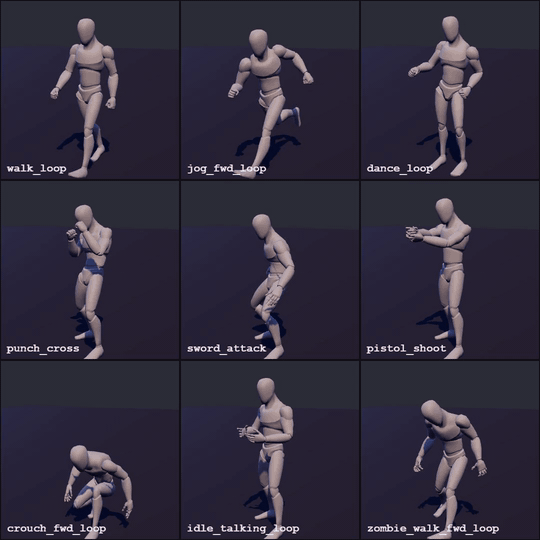
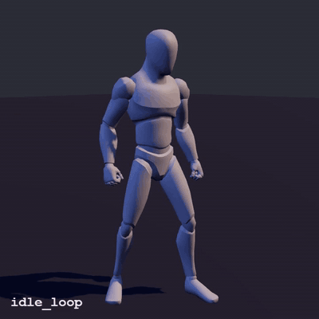

# 3d-animate

An agent skill for animating rigged humanoids in 3D with Remotion +
three.js / react-three-fiber. Point it at a humanoid rig and a set of mocap
clips, and it plays, blends and renders them frame-accurately.

## Demo

<p align="center">
  
  
</p>

<p align="center"><sub>
Left: one rig, nine CC0 clips (walk, jog, dance, punch, sword, pistol, crouch, talk, zombie walk).<br>
Right: the same rig chaining clips with 10-frame cross-fades: idle → walk → jog → dance → punch → sword → idle.
</sub></p>

## What it does

- **Any clip on one rig.** It plays CC0 mocap clips from the
  [ActionForge](https://actionforge.app) / Quaternius library (89 clips: locomotion,
  combat, interaction, gestures, reactions) on a 71-bone humanoid rig.
- **Deterministic playback.** No clocks. Every frame sets each action's time and
  weight, then evaluates the pose (`mixer.update(0)`), so renders are
  reproducible and can be scrubbed.
- **Blending.** `layers` takes `{clip, t, weight}` entries. Cross-fade
  weights to chain clips (walk → sit) or mix them.
- **Root motion.** Clips play in place, or `travel` moves the character by
  the clip's own velocity so the feet don't slide.
- **Attachments.** Props can ride on any bone (hands, head, chest).
- **Custom clips.** For moves the library doesn't have, it can capture motion from
  video, retarget it onto the rig, and clean it up
  ([`references/custom-capture.md`](references/custom-capture.md)).
- **Visual QA.** `stills.mjs` renders chosen frames and tiles a contact sheet,
  and the `ClipGrid` composition checks a rig and its clips before anything is built on them.

## Install

Clone this repo into your agent's skills directory. For example, for Claude Code:

```bash
git clone https://github.com/kaiji123/3danimate.git ~/.claude/skills/3d-animate
```

Requirements: Node 18+ and Python 3.10+. Remotion downloads its own headless
Chrome on the first render.

## Usage

Ask your agent, for example: *"Animate a mannequin doing a walk, then a punch, and
render it to MP4."* [`SKILL.md`](SKILL.md) walks the agent through
scaffolding a project, fetching clips, driving them and rendering.

By hand:

```bash
python ~/.claude/skills/3d-animate/scripts/scaffold.py my-anim && cd my-anim && npm install
python scripts/fetch_actionforge.py list                       # browse clips (all CC0)
python scripts/fetch_actionforge.py get public/anims idle_loop walk_loop jog_fwd_loop dance_loop \
  punch_cross sword_attack pistol_shoot crouch_fwd_loop idle_talking_loop zombie_walk_fwd_loop
npx remotion render src/index.ts ClipChain out/clip-chain.mp4   # or ClipGrid
```

New clips go in `public/anims/` and in `CLIP_NAMES` (`src/three/assets.ts`).

Driving a clip in a scene:

```tsx
import { Mannequin } from "./three/Mannequin";

const s = useSecs();                                   // seconds since the shot started
<Mannequin layers={[{ clip: "walk_loop", t: s }]} />

// cross-fade walk → punch (w goes 0 → 1 over ~10 frames)
<Mannequin layers={[
  { clip: "walk_loop",   t: s, weight: 1 - w },
  { clip: "punch_cross", t: s, weight: w },
]} />
```

## Repo layout

```
SKILL.md        workflow + hard rules (entry point for the agent)
references/     characters & clips, custom capture, look, QA
scripts/        scaffold, ActionForge clip fetcher, contact sheet, helpers
templates/      the Remotion project the scaffold copies
media/          README demo assets
```

## Credits and licences

- **Animations and rig:** created by [Quaternius](https://quaternius.com) and
  dedicated to the public domain ([CC0 1.0](https://creativecommons.org/publicdomain/zero/1.0/)).
  If they're useful to you, consider supporting him on
  [Patreon](https://www.patreon.com/quaternius).
- **Retargeting and hosting:** the clips are fetched from the CC0 library of
  [ActionForge](https://actionforge.app) by CGstuff, which retargets and hosts
  them under the same CC0 terms. `fetch_actionforge.py` downloads only those
  CC0 asset files. It skips files you already have and spaces out requests, so
  please fetch only the clips you use. ActionForge's app code is proprietary and
  is not used or copied here.
- This project is **not affiliated with or endorsed by** Quaternius or ActionForge.
- Optional story extras: face portraits and reference photos are yours to
  source. Use only images you have the rights to, and log them in the
  `SOURCES.txt` files.
- **This repo's code and docs:** [MIT](LICENSE). The licence covers this
  repo only, not the downloaded animations (CC0) or ActionForge's app.
