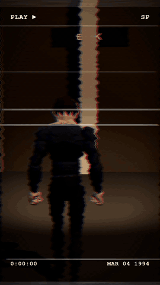
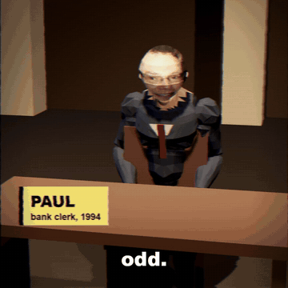
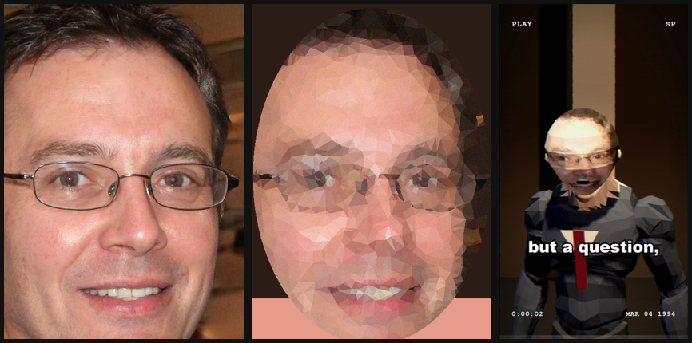

# 3d-animate

An agent skill for making fully generated **low-poly 3D story shorts**
(vertical 1080×1920, ~60 s) with Remotion + three.js / react-three-fiber.
Narration, word-timed hard cuts, mocap-animated characters with photo-mosaic
faces, captions, pop-ups, synthesized music/SFX and an optional VHS look —
no stock footage, nothing to license.

## Demo

<table>
  <tr>
    <td align="center" valign="top">
      <br>
      <sub>The template's example video, rendered as-is<br>(<a href="media/demo-short.mp4">MP4 with sound</a>)</sub>
    </td>
    <td align="center" valign="top">
      <br>
      <sub>Hard cuts land on narration words; pop-ups (<code>x2</code>),<br>captions and VHS cut-glitches are timed from the TTS word boundaries</sub>
    </td>
  </tr>
</table>

**Faces:** an AI-generated portrait (no real person) → low-poly mosaic
texture → head on a mocap-animated character.



Everything above was produced by the skill's own pipeline: `scaffold.py` →
`fetch_actionforge.py` (CC0 clips) → `process_faces.py` → `generate_audio.py`
(edge-tts) → `generate_sfx.py` → `remotion render`. A full short follows the
same steps with a longer script (150–170 words, 7–10 scenes).

## What it does

- **Word-timed editing** — scenes ask `wordFrame("desk", "twice")` instead of
  hard-coding seconds; re-recording the narration re-times every cut.
- **Mocap characters** — CC0 Quaternius/ActionForge clips on a low-poly
  mannequin, clothed by bone weight, driven deterministically per frame.
- **Photo-mosaic faces** with runtime expressions (open mouth, frown, closed
  eyes, angry brows).
- **Canonical props** modelled once from Wikimedia Commons reference photos,
  verified on a model-sheet composition.
- **Look & sound** — captions, pop-ups, stamps, name tags, VHS filter + OSD,
  numpy-synthesized music bed and SFX.
- **Visual QA loop** — `stills.mjs` renders frames by scene id and tiles a
  contact sheet; `references/qa.md` maps symptoms to fixes.

## Install

Clone this repo into your agent's skills directory, e.g. for Claude Code:

```bash
git clone <this-repo-url> ~/.claude/skills/3d-animate
```

Requirements: Node 18+, Python 3.10+, `ffmpeg`/`ffprobe` on PATH.

```bash
pip install "edge-tts>=7.3" numpy scipy pillow
```

> Make sure `edge-tts` is installed for the same Python that runs the scripts —
> older versions get HTTP 403 from the TTS endpoint.

## Usage

Ask your agent for a video, e.g. *"Make a 60-second low-poly short about the
Antwerp diamond heist."* The skill's [`SKILL.md`](SKILL.md) walks
the agent through scaffolding, story, voice, casting, clips, props, scenes, QA
and the final render.

To try the example by hand:

```bash
python ~/.claude/skills/3d-animate/scripts/scaffold.py my-short && cd my-short && npm install
python scripts/fetch_actionforge.py get public/anims idle_loop idle_talking_loop walk_formal_loop sitting_idle_loop yes interact
# put an AI-generated portrait at assets/faces-src/clerk.jpg, then:
python scripts/process_faces.py
python scripts/generate_audio.py example
python scripts/generate_sfx.py
npx remotion render src/index.ts Example out/example.mp4
```

## Repo layout

```
SKILL.md        workflow + hard rules (entry point for the agent)
references/     story & timing, characters, props, look & sound, QA, custom capture
scripts/        scaffold, audio, sfx, faces, ActionForge, Commons refs, contact sheet
templates/      the Remotion project the scaffold copies
media/          README demo assets
```
